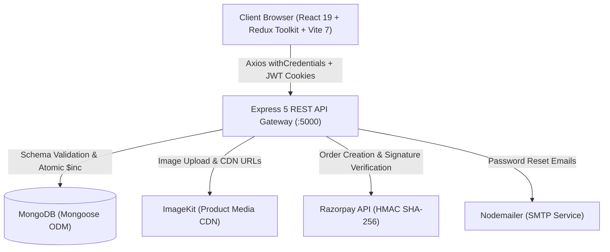
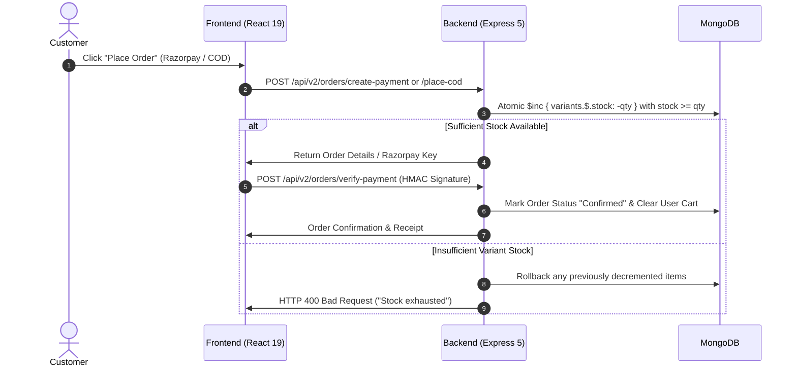

# Urban Loom — Contemporary Apparel E-Commerce Platform

[](https://react.dev/)
[](https://vitejs.dev/)
[](https://tailwindcss.com/)
[](https://redux-toolkit.js.org/)
[](https://nodejs.org/)
[](https://expressjs.com/)
[](https://www.mongodb.com/)
[](https://razorpay.com/)

> **Urban Loom** is a full-stack MERN e-commerce web application engineered for contemporary apparel. Built with modern web standards (React 19, Vite 7, Tailwind CSS v4, Express 5, and MongoDB Mongoose), the project demonstrates scalable e-commerce architecture, atomic inventory management, secure double-token authentication, dual payment processing (Razorpay + COD), and an administrative control panel.

---

## Table of Contents

- [Key Highlights](#key-highlights)
- [Architecture & Design](#architecture--design)
- [Features](#features)
  - [Customer Storefront](#customer-storefront)
  - [Cart & Checkout Flow](#cart--checkout-flow)
  - [Admin Management Suite](#admin-management-suite)
- [Technology Stack](#technology-stack)
- [Project Directory Structure](#project-directory-structure)
- [Installation & Setup](#installation--setup)
  - [1. Prerequisites](#1-prerequisites)
  - [2. Clone Repository](#2-clone-repository)
  - [3. Backend Setup](#3-backend-setup)
  - [4. Frontend Setup](#4-frontend-setup)
  - [5. Seed Sample Products](#5-seed-sample-products)
- [Environment Variables Guide](#environment-variables-guide)
- [Deploying to Render (Blueprint)](#deploying-to-render-blueprint)
- [REST API Reference](#rest-api-reference)
- [College Presentation & Viva Talking Points](#college-presentation--viva-talking-points)
- [License & Acknowledgments](#license--acknowledgments)

---

## Key Highlights

- **Atomic Stock Management**: Eliminates race conditions and Mongoose `VersionError` crashes during concurrent checkouts using sequential atomic MongoDB `$inc` operations with rollbacks.
- **Resilient Cloud SDK Integrations**: ImageKit, Razorpay, and Nodemailer clients are configured with lazy-loading proxies so missing external credentials will not prevent local server boots or viva evaluation.
- **Double-Token JWT Security**: Implements short-lived `AccessToken` and long-lived `RefreshToken` stored in `HttpOnly` and `SameSite` cookies with automated silent token rotation via Axios response interceptors.
- **Guest-to-Account Cart Merging**: Guests can curate carts in browser `localStorage`; upon registration or login, items are merged into their MongoDB cloud cart with real-time stock clamping.
- **Contemporary Design Language**: Styled with Tailwind CSS v4 using an Obsidian (`#0B1110`), Surface (`#131D1B`), Emerald (`#10B981`), and Gold (`#F0C44C`) palette.

---

## Architecture & Design



### High-Concurrency Order & Stock Pipeline



---

## Features

### Customer Storefront
- **Responsive Navigation**: Header with quick search, category filtering, live guest/authenticated cart counter, and user profile drawer.
- **Hero Showcase**: Prominent hero banner featuring real-time catalog statistics, dynamic CTA buttons, and promo announcements.
- **Product Filtering & Specs**: Filter apparel by Price, Category, and fabric specifications (GSM weight, Cotton/Linen/Blend).
- **Product Detail View**: High-resolution image preview, color and size variant selector with dynamic stock badges ("Low Stock", "Out of Stock"), customer reviews, and fabric composition specs.
- **Static & Support Suite**: Fully working pages for About, Contact (with interactive query form), FAQs, Shipping Info, Terms of Service, and Privacy Policy.

### Cart & Checkout Flow
- **Universal Cart Experience**: Works offline and for guest visitors via `localStorage`; seamlessly syncs with the database upon user authentication.
- **Multi-Address Book**: Add, edit, delete, and designate default shipping addresses with pin code validation.
- **Dual Payment Methods**:
  - **Online Payment**: Razorpay integration with client-side checkout modal and backend HMAC SHA-256 signature verification.
  - **Cash on Delivery (COD)**: One-click order creation for offline settlement.
- **Order Tracking & Lifecycle**: Customer dashboard displaying active and historical orders, order status tags (`Pending`, `Confirmed`, `Shipped`, `Delivered`, `Cancelled`), and customer-initiated cancellations with automated inventory restock.

### Admin Management Suite
- **Role-Based Access Control**: Route guards (`isAdmin`) preventing unauthorized users from accessing admin routes.
- **Product Inventory Control**:
  - Add new products with file upload to ImageKit.
  - Edit existing products, pricing, descriptions, and GSM fabric weights.
  - Variant-level restock control with quick quantity adjustments.
  - Safe deletion with cloud image cleanup.
- **Category Management**: Create and organize apparel categories with duplicate prevention.
- **Order Pipeline Oversight**: Filter all customer orders, inspect order items and delivery addresses, and advance order status through fulfillment stages.

---

## Technology Stack

| Layer | Technologies |
| :--- | :--- |
| **Frontend Framework** | React 19.2, Vite 7.2 |
| **State Management** | Redux Toolkit 2.12, React-Redux 9.3 |
| **Routing** | React Router v7.11 |
| **Styling & UI Icons** | Tailwind CSS v4.1, Lucide React 0.562 |
| **HTTP Client** | Axios 1.18 (Custom interceptors with cookie credentials) |
| **Backend Runtime** | Node.js (v18.x or v20.x recommended) |
| **Server Framework** | Express 5.1 |
| **Database & ODM** | MongoDB, Mongoose 8.19 |
| **Security & Utilities** | Helmet 8.2, Morgan 1.11, Express Rate Limit 8.5, Bcrypt 6.0 |
| **Authentication** | JSON Web Tokens (`jsonwebtoken` 9.0), Cookie-Parser 1.4 |
| **File Handling** | Multer 2.0 (Local buffer) + ImageKit SDK 6.0 (Cloud CDN) |
| **Payment Gateway** | Razorpay SDK 2.9 (HMAC SHA-256 verification) |
| **Email Notification** | Nodemailer 9.0 (SMTP password recovery) |

---

## Project Directory Structure

```text
Urban-Loom/
├── backend/
│   ├── controllers/            # Route controllers (MVC architecture)
│   │   ├── Address.controllers.js
│   │   ├── Cart.controllers.js
│   │   ├── Category.controllers.js
│   │   ├── Order.controllers.js
│   │   ├── Product.controllers.js
│   │   └── User.controller.js
│   ├── middleware/             # Custom express middlewares
│   │   ├── Errorhandler.middleware.js # Centralized Mongoose error normalizer
│   │   ├── auth.middleware.js         # JWT & Admin role verification
│   │   └── multer.middleware.js       # Disk storage configuration
│   ├── routes/                 # Express API route declarations
│   ├── script/                 # Database seed utilities & sample data
│   │   ├── SeedProducts.js
│   │   └── product.example.json
│   ├── src/
│   │   ├── db/                 # MongoDB Mongoose connection handler
│   │   ├── models/             # Mongoose schemas (User, Product, Order, etc.)
│   │   ├── utils/              # Resilient ImageKit, Razorpay, and Mailer clients
│   │   ├── app.js              # Express app configuration & middlewares
│   │   ├── constants.js        # Global constants (DB name, etc.)
│   │   └── index.js            # Server entrypoint (:5000)
│   ├── .env.sample             # Backend environment template
│   └── package.json
│
├── frontend/
│   ├── public/                 # Static assets, SVG branding & _redirects (SPA routing)
│   ├── src/
│   │   ├── api/                # Axios instance & token refresh interceptor
│   │   ├── components/         # Reusable UI widgets (Header, Footer, Cart, ProductCard)
│   │   ├── pages/              # Primary view pages
│   │   │   ├── Home.jsx        # Landing page with stats & catalog
│   │   │   ├── InfoPage.jsx    # About, Contact, FAQ, Terms, Shipping views
│   │   │   ├── MyOrders.jsx    # Order history & cancellation
│   │   │   ├── NotFound.jsx    # 404 handler
│   │   │   └── admin/          # Admin layout, products, categories, orders
│   │   ├── store/              # Redux slices (cart, user, product, order)
│   │   ├── App.jsx             # Top-level shell
│   │   ├── index.css           # Tailwind CSS v4 styling & color tokens
│   │   └── main.jsx            # React 19 root bootstrap & routing
│   ├── .env.sample             # Frontend environment template
│   ├── index.html              # HTML shell & font definitions
│   ├── vite.config.js          # Vite build & plugin configuration
│   └── package.json
│
├── render.yaml                 # Render Blueprint specification
└── README.md                   # Project documentation
```

---

## Installation & Setup

### 1. Prerequisites
- **Node.js**: `v18.18.0` or higher (Verify with `node -v`)
- **npm**: `v9.x` or higher (Verify with `npm -v`)
- **MongoDB**: A running local MongoDB instance (`mongodb://127.0.0.1:27017/userDB`) or a free [MongoDB Atlas](https://www.mongodb.com/cloud/atlas) cluster URI.

### 2. Clone Repository
```bash
git clone https://github.com/jatin50/JMW_-project_website.git urban-loom
cd urban-loom
```

### 3. Backend Setup
1. Navigate to the `backend` folder and install dependencies:
   ```bash
   cd backend
   npm install
   ```

2. Create your `.env` configuration file from the template:
   ```bash
   cp .env.sample .env
   ```
   *(On Windows PowerShell: `Copy-Item .env.sample .env`)*

3. Configure your MongoDB connection string in `.env`:
   ```env
   PORT=5000
   MONGO_URI=mongodb://127.0.0.1:27017/userDB
   ACCESS_TOKEN_SECRET=urban_loom_access_token_secret_key_2026
   REFRESH_TOKEN_SECRET=urban_loom_refresh_token_secret_key_2026
   CORS_ORIGIN=http://localhost:5173
   FRONTEND_URL=http://localhost:5173
   ```
   > [!NOTE]
   > `RAZORPAY_*`, `IMAGEKIT_*`, and `SMTP_*` variables can remain as dummy values during basic local testing. All controllers use resilient lazy initialization.

4. Start the backend development server:
   ```bash
   npm run dev
   ```
   *The server starts on `http://localhost:5000`. You can visit `http://localhost:5000/` to verify health.*

### 4. Frontend Setup
1. Open a new terminal window, navigate to the `frontend` folder, and install dependencies:
   ```bash
   cd ../frontend
   npm install
   ```

2. Confirm or create the frontend `.env`:
   ```env
   VITE_API_URL=http://localhost:5000/api/v2
   ```

3. Launch the Vite development server:
   ```bash
   npm run dev
   ```
   *The client will launch at `http://localhost:5173`.*

### 5. Seed Sample Products (Optional)
To quickly populate your catalog with sample apparel items:
1. Ensure your MongoDB instance is running and reachable via `backend/.env`.
2. Run the seeding script from the `backend` folder:
   ```bash
   cd backend
   npm run seed
   ```

---

## Environment Variables Guide

### Backend (`backend/.env`)

| Variable Name | Required | Default / Description |
| :--- | :---: | :--- |
| `PORT` | No | `5000` — Port on which Express server listens |
| `NODE_ENV` | No | `development` — Set to `production` for secure cookie flags |
| `MONGO_URI` | **Yes** | Connection string (e.g., `mongodb://127.0.0.1:27017/userDB`) |
| `CORS_ORIGIN` | **Yes** | `http://localhost:5173` — Whitelisted frontend origin |
| `FRONTEND_URL` | **Yes** | `http://localhost:5173` — Used for constructing password reset links |
| `ACCESS_TOKEN_SECRET` | **Yes** | Cryptographic secret for signing short-lived JWT access tokens |
| `ACCESS_TOKEN_EXPIRY` | No | `1d` — Access token lifetime |
| `REFRESH_TOKEN_SECRET`| **Yes** | Cryptographic secret for signing long-lived JWT refresh tokens |
| `REFRESH_TOKEN_EXPIRY`| No | `7d` — Refresh token lifetime |
| `IMAGEKIT_PUBLIC_KEY` | Optional | Public key from ImageKit developer dashboard |
| `IMAGEKIT_PRIVATE_KEY`| Optional | Private key for server-side ImageKit media uploads |
| `IMAGEKIT_URL_ENDPOINT`| Optional| ImageKit endpoint URL (e.g. `https://ik.imagekit.io/<id>`) |
| `RAZORPAY_KEY_ID`     | Optional | Razorpay Key ID for initiating online checkout |
| `RAZORPAY_KEY_SECRET` | Optional | Razorpay Secret Key for HMAC SHA-256 signature verification |
| `SMTP_HOST`           | Optional | SMTP Server host (e.g., `smtp.gmail.com`) |
| `SMTP_PORT`           | Optional | `587` — SMTP port |
| `SMTP_USER`           | Optional | Sender email account |
| `SMTP_PASS`           | Optional | SMTP App password |

### Frontend (`frontend/.env`)

| Variable Name | Required | Description |
| :--- | :---: | :--- |
| `VITE_API_URL` | **Yes** | Full base URL of the backend API (e.g. `http://localhost:5000/api/v2`) |

---

## Deploying to Render (Blueprint)

This repository includes a production-ready **Render Blueprint** (`render.yaml`) that automatically provisions both the **Express Web Service** and the **Vite Static Site** with a single click.

### Step-by-Step Deployment

1. **Push Changes to GitHub**:
   Ensure all changes and `render.yaml` are pushed to your GitHub repository:
   ```bash
   git add .
   git commit -m "Configure Render blueprint and security headers"
   git push origin main
   ```

2. **Connect to Render**:
   - Go to [dashboard.render.com](https://dashboard.render.com/).
   - Click **New +** in the top navigation bar and select **Blueprint**.
   - Connect your GitHub account and choose your `urban-loom` repository.

3. **Configure Environment Variables**:
   Render will inspect `render.yaml` and prompt you to input the secret credentials:
   - `MONGO_URI`: Your MongoDB Atlas connection string.
   - `IMAGEKIT_PUBLIC_KEY`, `IMAGEKIT_PRIVATE_KEY`, `IMAGEKIT_URL_ENDPOINT`: From your ImageKit dashboard.
   - `RAZORPAY_KEY_ID`, `RAZORPAY_KEY_SECRET`: From your Razorpay dashboard (or dummy test keys).
   - `SMTP_*`: Your email credentials for password resets.

4. **Service Linking**:
   - `CORS_ORIGIN` & `FRONTEND_URL`: Set to your frontend URL (e.g., `https://urban-loom-frontend.onrender.com`).
   - `VITE_API_URL`: Set to your backend API URL (e.g., `https://urban-loom-backend.onrender.com/api/v2`).

5. **Deploy**:
   Click **Apply**. Render will automatically build the React Vite frontend, deploy the Express API, generate cryptographically random `ACCESS_TOKEN_SECRET` and `REFRESH_TOKEN_SECRET` keys, configure SSL, and activate health checks.

### Production Security Checklist

- [x] **Reverse Proxy Trust**: `app.set("trust proxy", 1)` enabled for accurate IP throttling and secure cookies behind Render's load balancer.
- [x] **Cross-Origin Resource Policy (CORP)**: Configured with `cross-origin` policy so ImageKit CDN photos load without browser blocking.
- [x] **Dual Rate Limiting**: Global limiter on `/api` (300 req/15 min) + strict limiter on `/login`, `/register`, and `/forgot-password` (20 req/15 min).
- [x] **Double-Token Security**: `HttpOnly`, `SameSite=None`, and `Secure` cookies for cross-domain production authentication.
- [x] **SPA Routing Preservation**: `frontend/public/_redirects` ensures direct visits or browser reloads on `/cart`, `/info/*`, and `/admin` never 404.

---

## REST API Reference

### Authentication & User (`/api/v2/users`)
- `POST /register` — Register a new customer or admin account.
- `POST /login` — Authenticate with email/username + password; sets `accesstoken` & `refreshtoken` cookies.
- `POST /logout` — Invalidate user session and clear authentication cookies (Protected).
- `POST /refresh-token` — Issue a new access token using the stored refresh cookie.
- `GET /me` — Retrieve the authenticated profile and role details (Protected).
- `POST /change-password` — Update account password with old-password verification (Protected).
- `POST /forgot-password` — Dispatch a password reset token via SMTP mail.
- `POST /reset-password/:token` — Set a new password using a verified recovery token.

### Products & Cart (`/api/v2/products`)
- `GET /` — Fetch paginated product catalog with category, search, and price filters.
- `GET /:productId` — Retrieve single product details with all variant combinations.
- `POST /upload-product` — Upload a new product with image attachment (Admin only).
- `PATCH /:productId` — Update product details and specifications (Admin only).
- `DELETE /:productId` — Remove product and purge associated cloud images (Admin only).
- `PATCH /:productId/variants/:variantId/restock` — Adjust variant stock inventory (Admin only).
- `GET /cart` — Fetch user's persistent cart (Protected).
- `POST /cart/:productId` — Add item variant to user cart (Protected).
- `DELETE /cart/:productId/:variantId` — Remove variant from cart (Protected).
- `PATCH /cart/:productId/:variantId/decrease` — Decrement variant quantity in cart (Protected).

### Orders & Payments (`/api/v2/orders`)
- `GET /` — Fetch order history for the authenticated user (Protected).
- `GET /:orderId` — View detailed breakdown of a specific order (Protected).
- `POST /create-payment` — Generate a Razorpay order ID with server-side amount calculation (Protected).
- `POST /verify-payment` — Verify cryptographic Razorpay signature and commit order (Protected).
- `POST /place-cod` — Place Cash on Delivery order with immediate inventory deduction (Protected).
- `PATCH /:orderId/cancel` — Cancel an order and automatically restock variant quantities (Protected).
- `GET /admin/all` — Retrieve all customer orders across the platform (Admin only).
- `PATCH /admin/:orderId/status` — Advance order status (`Pending` -> `Confirmed` -> `Shipped` -> `Delivered`) (Admin only).

### Categories & Addresses
- `GET /api/v2/categories` — List all apparel categories.
- `POST /api/v2/categories` — Create a new category with case-insensitive uniqueness check (Admin only).
- `GET /api/v2/addresses` — List user's delivery addresses (Protected).
- `POST /api/v2/addresses` — Add a new shipping address (Protected).
- `PATCH /api/v2/addresses/:addressId` — Update an existing address (Protected).
- `DELETE /api/v2/addresses/:addressId` — Delete an address with fallback default promotion (Protected).
- `PATCH /api/v2/addresses/:addressId/default` — Designate an address as the primary shipping destination (Protected).

---

## College Presentation & Viva Talking Points

When presenting this project for your academic evaluation or viva voce, here are the key architectural decisions to highlight:

1. **How does the system prevent race conditions during high-volume checkouts?**
   > *"Rather than fetching a document into Node.js memory, mutating it, and calling `.save()` (which causes `VersionError` under concurrency), we perform atomic sequential MongoDB `$inc` updates directly in the database (`stock: { $gte: quantity }`). If any item in the order fails the condition, an automated compensation rollback restores previously decremented items and rejects the checkout."*

2. **Why use HTTP-only cookies instead of storing JWT in `localStorage`?**
   > *"`localStorage` is vulnerable to Cross-Site Scripting (XSS) attacks. By storing our access and refresh tokens inside `HttpOnly`, `SameSite=Lax`, and `Secure` cookies, scripts running in the browser cannot read the token strings. In addition, our Axios client utilizes an interceptor that catches `401 Unauthorized` responses and silently requests a refreshed access token without interrupting the user's flow."*

3. **How does the Guest Cart merge into the Authenticated Cart?**
   > *"When an unauthenticated guest browses the site, their cart state is maintained in Redux and synchronized with browser `localStorage`. Upon logging in or completing registration, the frontend dispatches a merge sequence that sends each guest item to the backend, clamping quantities against real-time database stock limits and clearing the temporary guest storage."*

4. **Why Express 5 and React 19?**
   > *"Express 5 brings native asynchronous error handling, eliminating redundant `try/catch` wrappers and ensuring unhandled promise rejections are piped straight to our centralized error middleware. React 19 provides enhanced rendering optimizations, paired with Vite 7 for lightning-fast Hot Module Replacement (HMR) and Tailwind CSS v4's modern engine."*

5. **How are 3rd-party services prevented from breaking local evaluation?**
   > *"External services like ImageKit, Razorpay, and Nodemailer are initialized via lazy getter functions rather than top-level constructor calls. This guarantees that evaluators can run the server and test core CRUD, navigation, and COD flows without requiring active third-party API keys."*

---

## License & Acknowledgments

- **License**: Released under the [ISC License](https://opensource.org/licenses/ISC).
- **Developed for**: Academic Project Presentation & Technical Portfolio Showcase.
